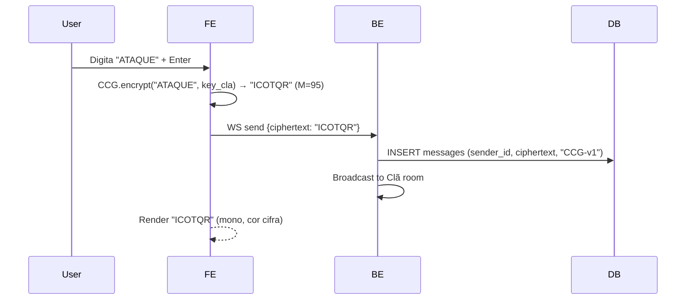
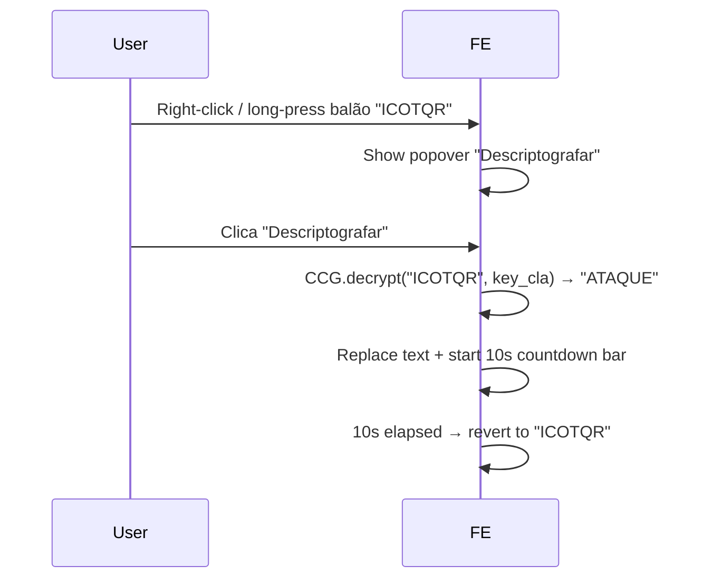

# Especificação Funcional — Chat Clã (Cifra do Conselho de Guerra)

**Versão:** 1.0  
**Data:** 2026-11-17  
**Projeto:** Chat Clã + CCG (Academic — Segurança de SI)

---

## 1. Visão Geral
Sistema de chat em tempo real onde **toda mensagem é cifrada automaticamente pela Cifra do Conselho de Guerra (CCG)** antes de persistir/transmitir. O histórico exibe apenas ciphertext; o usuário revela o plaintext via interação explícita (clique direito / long-press) por 10 segundos.

---

## 2. Atores
| Ator | Descrição |
|------|-----------|
| **Membro do Clã** | Usuário autenticado (nome de guerra único + senha) |
| **Sistema** | Frontend (Next.js) + Backend (Fastify) + DB (PostgreSQL) |

---

## 3. Requisitos Funcionais (RF)

### 3.1 Autenticação e Acesso
| ID | Requisito | Critério de Aceite |
|----|-----------|-------------------|
| **RF01** | Cadastro de membro | POST `/auth/register` → cria usuário com `username` único, `password_hash` (bcrypt/Argon2id), `rank='Recruta'` |
| **RF02** | Login + sessão | POST `/auth/login` → valida hash, emite JWT assinado, grava em cookie `HttpOnly; SameSite=Strict; Path=/` |
| **RF03** | Middleware de sessão | Next.js valida cookie em rotas protegidas; redireciona para `/chat` (sala Clã) |
| **RF04** | Logout | Limpa cookie, invalida sessão local |

### 3.2 Sala de Comando (Chat Clã)
| ID | Requisito | Critério de Aceite |
|----|-----------|-------------------|
| **RF05** | Listagem de membros ativos | WebSocket `presence` channel mostra usuários online |
| **RF06** | Histórico de mensagens | Carrega últimas N mensagens (ciphertext) do PostgreSQL ordenadas por `created_at` |
| **RF07** | Envio de mensagem | Input → cifra CCG (M=95, chave do Clã) → persiste `ciphertext` → broadcast WS |
| **RF08** | Recebimento tempo real | WS entrega `ciphertext`; UI renderiza apenas cifra |
| **RF09** | Exibição padrão cifrada | Balão de mensagem mostra `ciphertext` (fonte mono, cor distinta) |

### 3.3 Descriptografia Sob Demanda
| ID | Requisito | Critério de Aceite |
|----|-----------|-------------------|
| **RF10** | Menu contextual desktop | `onContextMenu` suprime menu nativo → popover estilo iOS com "Descriptografar" |
| **RF11** | Menu contextual mobile | `onTouchStart` + 500ms hold → mesmo popover com feedback háptico/visual |
| **RF12** | Revelação temporária | Clique em "Descriptografar" → aplica `D(c_i, i)` localmente → mostra plaintext + barra regressiva 10s |
| **RF13** | Auto-ocultação | Após 10s → substitui plaintext por ciphertext automaticamente |
| **RF14** | Isolamento por sessão | Descriptografia ocorre **apenas no cliente solicitante**; outros veem cifra |

### 3.4 Academia da Cifra (Módulo Educacional)
| ID | Requisito | Critério de Aceite |
|----|-----------|-------------------|
| **RF15** | Manual Histórico | Página scrollable com timeline ilustrada (generais, César, análise de frequência, CCG) |
| **RF16** | Raio-X Matemático | Explicação visual de `a, b, s, M, mdc(a,M)=1, a⁻¹` com fórmulas renderizadas (MathJax/KaTeX) |
| **RF17** | Laboratório Interativo (Sandbox) | Input: texto + chaves (a,b,s) → tabela animada passo a passo: `i, p_i, conta, c_i, char` + inversa |
| **RF18** | Desafios do Recruta | 3 níveis (Iniciante/Estrategista/General): mensagem cifrada + chaves → input resposta → valida → badge no perfil |

### 3.5 Painel de Apresentação (Modo Demo)
| ID | Requisito | Critério de Aceite |
|----|-----------|-------------------|
| **RF19** | Inspeção Matemática | Modal: insere texto arbitrário → mostra cálculo completo com valores numéricos (M=26 e M=95) |
| **RF20** | 5 Testes Obrigatórios | Botão executa casos de teste da spec (ATAQUE→ICOTQR etc.) e exibe PASS/FAIL |

---

## 4. Requisitos Não Funcionais (RNF)

| ID | Requisito | Detalhamento |
|----|-----------|-------------|
| **RNF01** | Hash de senha | bcrypt cost ≥12 ou Argon2id; salt único por usuário |
| **RNF02** | Cookie seguro | JWT em cookie `HttpOnly; SameSite=Strict; Secure` (prod) |
| **RNF03** | Persistência apenas ciphertext | Coluna `messages.ciphertext` TEXT NOT NULL; **nunca** salva plaintext |
| **RNF04** | WebSocket autenticado | Handshake valida cookie de sessão; rejeita se inválido |
| **RNF05** | Docker Compose one-shot | `docker compose up -d` sobe Postgres 16-alpine + healthcheck + volume `pgdata_cla` |
| **RNF06** | Responsividade | Touch targets ≥44×44px; 60fps animações; contraste AA (WCAG) |
| **RNF07** | Design System Apple + Terroso | Tokens de cor, tipografia SF/Inter, blur/translucidez, cantos 16-20px, spring/ease-out |

---

## 5. Chave Tática do Clã (Parâmetros Fixos para Demo)
| Parâmetro | Valor | Papel |
|-----------|-------|-------|
| `M` | 95 (ASCII 32-126) | Alfabeto imprimível completo |
| `a` | 5 | Multiplicador de dispersão (mdc(5,95)=5 ❌ → **ajustar para coprimo**, ex.: 7, 11, 13...) |
| `b` | 8 | Deslocamento base da sala |
| `s` | 3 | Passo tático (evolução posicional) |

> **Nota:** Para M=95, `a` deve ser coprimo de 95 (5×19). Valores válidos: 2, 3, 4, 6, 7, 8, 9, 11, 12, 13, 14, 16, 17, 18, 21, 22, 23, 24... **Recomendado: `a=7`** (simples, coprimo).

---

## 6. Fluxos Principais

### 6.1 Cadastro → Login → Chat
```mermaid
sequenceDiagram
    User->>FE: /register (username, password)
    FE->>BE: POST /auth/register
    BE->>DB: INSERT users (username, password_hash)
    BE-->>FE: 201 Created
    User->>FE: /login (username, password)
    FE->>BE: POST /auth/login
    BE->>DB: SELECT password_hash
    BE->>BE: bcrypt.verify + sign JWT
    BE-->>FE: Set-Cookie: token=...; HttpOnly; SameSite=Strict
    FE->>FE: Redirect /chat
    FE->>BE: WS connect (cookie)
    BE->>BE: validate JWT from cookie
    BE-->>FE: WS open + history + presence
```

### 6.2 Envio e Recebimento de Mensagem


### 6.3 Descriptografia Sob Demanda


---

## 7. Casos de Teste Obrigatórios (Validação Acadêmica)
| # | Input (M=26, a=5,b=8,s=3) | Cipher Esperado | Decipher Esperado |
|---|---------------------------|-----------------|-------------------|
| 1 | `ATAQUE` | `ICOTQR` | `ATAQUE` |
| 2 | `TROPAS` | `ZJGVQJ` | `TROPAS` |
| 3 | `DEFESA` | `LMDXKM` | `DEFESA` |
| 4 | `RECUAR` | `JMYNQF` | `RECUAR` |
| 5 | `VITORIA` | `BWHOZCC` | `VITORIA` |

> **Implementação real usa M=95** — testes acima servem para validação matemática da lógica (unidade).

---

## 8. Entregáveis
- Código-fonte completo (monorepo: `apps/web`, `apps/api`, `packages/ccg-core`)
- `docker-compose.yml` + `Dockerfile`s
- Documento técnico (este + arquitetura + modelo DB)
- Slides de apresentação (3 partes, 15 min)
- README com instruções de execução local

---

## 9. Fora de Escopo (v1)
- Criptografia ponta-a-ponta real (Signal/MLS) — CCG é didática
- Múltiplas salas/grupos — apenas **Clã** único
- Upload de arquivos/imagens
- Notificações push
- Admin panel / moderação